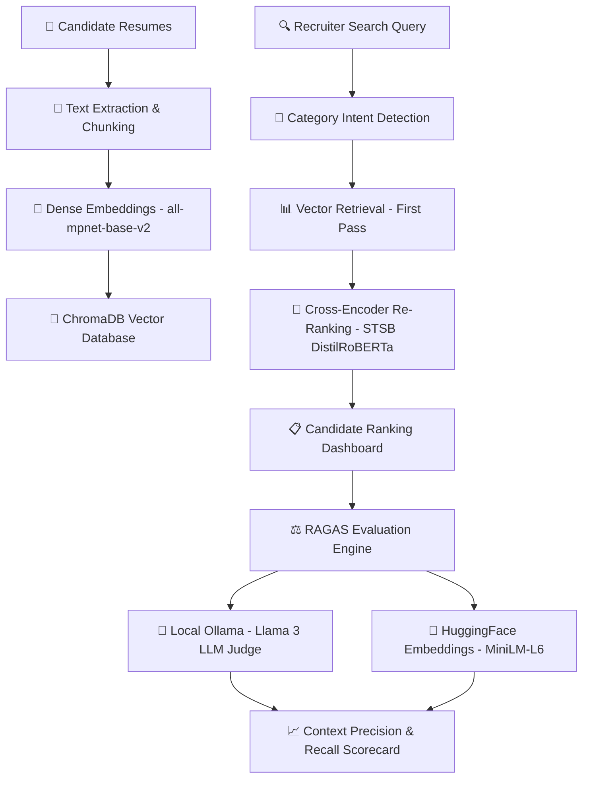

# 🎯 AI-Powered Resume Screening System with Offline RAG & Local Ollama Evaluation

An enterprise-grade, privacy-first AI application for automated resume screening, candidate ranking, and RAG evaluation. Built using Flask, ChromaDB vector store, Cross-Encoder re-ranking, and the RAGAS evaluation framework powered by local Ollama (Llama 3).

---

## 🌟 Key Features

* **🧠 Semantic & Keyword Hybrid Search:** Combines BM25-style keyword matching with `SentenceTransformers` (`all-mpnet-base-v2`) dense vector search.
* **🎯 Cross-Encoder Re-Ranking:** Uses `cross-encoder/stsb-distilroberta-base` to re-rank candidate resumes for maximum semantic relevance.
* **📁 Multi-Department Support:** Supports 24 specialized industry categories (Engineering, IT, HR, Healthcare, Finance, etc.) with automatic department intent detection.
* **🔒 100% Offline & Data Private:** Utilizes **local Ollama (Llama 3)** for LLM operations—candidate resumes and PII never leave local hardware.
* **📊 RAGAS Metric Evaluation Dashboard:** Integrated `/evaluate` page computing **Context Precision** and **Context Recall** metrics offline without external paid API keys.

---

## 🏗️ System Architecture



---

## 🛠️ Tech Stack

* **Backend Framework:** Python, Flask, SQLite3
* **Vector Database:** ChromaDB
* **Embeddings & Re-ranking:** `sentence-transformers`, `scikit-learn`
* **Local LLM Runner:** Ollama (`llama3`)
* **Evaluation Framework:** RAGAS, `langchain-ollama`, `langchain-community`

---

## 🚀 Quick Start Guide

### 1. Prerequisites
* Python 3.10+
* [Ollama Installed](https://ollama.com/) with `llama3` model downloaded (`ollama pull llama3`)

### 2. Installation
```bash
# Clone repository
git clone https://github.com/YOUR_USERNAME/AI-Resume-Screening-System.git
cd AI-Resume-Screening-System

# Install dependencies
pip install -r requirements.txt
```

### 3. Running the Application
```bash
# Ensure Ollama service is running locally
ollama serve

# Start Flask Web Application
python app.py
```
Open your browser and navigate to `http://127.0.0.1:5000/`.

---

## 📊 RAGAS Evaluation Dashboard

Navigate to `http://127.0.0.1:5000/evaluate` to run real-time retrieval evaluation:

1. Select **Local Ollama Llama 3 (Free)** from the dropdown.
2. Click **Run RAGAS Evaluation**.
3. View **Context Precision** (ranking quality) and **Context Recall** (skill completeness) scorecards.

---

## 🛡️ License & Privacy
Built with privacy-by-design principles. All processing occurs locally on host hardware.
