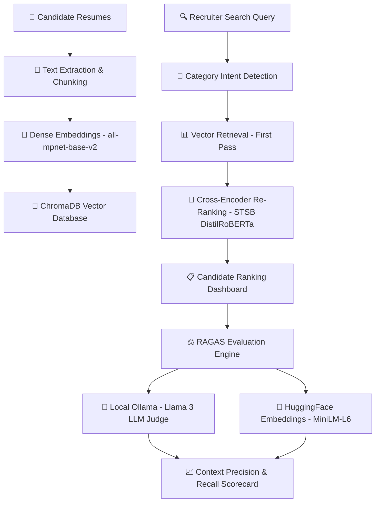

# 🎯 AI-Powered Resume Screening System with Offline RAG & Local Ollama Evaluation

An enterprise-grade, privacy-first AI application for automated resume screening, candidate ranking, and RAG evaluation. Built using Flask, ChromaDB vector store, Cross-Encoder re-ranking, and the RAGAS evaluation framework powered by local Ollama (Llama 3).

---

## 🌟 Key Features

* **🧠 Semantic & Keyword Hybrid Search:** Combines BM25-style keyword matching with `SentenceTransformers` (`all-mpnet-base-v2`) dense vector search (30% keyword + 70% semantic).
* **🎯 Cross-Encoder Re-Ranking:** Uses `cross-encoder/stsb-distilroberta-base` to re-rank candidate resumes for maximum semantic relevance.
* **📁 Multi-Department Support:** Supports 24 specialized industry categories (Engineering, IT, HR, Healthcare, Finance, etc.) with automatic department intent detection.
* **🔒 Enterprise Security Hardening:** Comprehensive CSRF protection on all mutating requests, cryptographic session cookies (HttpOnly, SameSite=Lax), strict file upload validation with MIME/magic byte inspection, password complexity enforcement, and path traversal defense.
* **🛡️ Production-Grade Error Handling:** Centralized custom error handlers (400, 403, 404, 413, 500), graceful fallbacks for vector database and cross-encoder models, and structured logging.
* **🧪 50-Test Automated Pytest Suite:** End-to-end automated testing covering authentication, resume parsing, AI retrieval pipeline, route validation, and security regressions.
* **📊 10-Department RAGAS Evaluation Dashboard:** Integrated `/evaluate` page computing **Context Precision** and **Context Recall** across 10 diverse reference benchmarks offline or using Ollama/OpenAI judges.

---

## 🏗️ System Architecture



---

## 🛡️ Security Architecture

| Security Domain | Implementation Details |
|---|---|
| **CSRF Defense** | Session-bound cryptographic tokens validated on all `POST`, `PUT`, `DELETE` requests via `secrets.compare_digest`. Embedded into forms via template context processor. |
| **Authentication & Password Rules** | Minimum 8 characters with both letters and numbers enforced. Passwords hashed using modern PBKDF2/Scrypt with unique salts via Werkzeug. |
| **Session Security** | Sessions configured with `SESSION_COOKIE_HTTPONLY=True`, `SESSION_COOKIE_SAMESITE="Lax"`, 8-hour expiration, and persistent cryptographic secret key generation. |
| **File Upload Defense** | Strict extension whitelist (`.pdf`, `.docx`), 16MB file limit (`MAX_CONTENT_LENGTH`), magic-byte header inspection (`%PDF-` and `PK\x03\x04`), and UUID-prefixed `secure_filename`. |
| **Path Traversal Protection** | Resume downloads validate against a strict department category whitelist and reject filename traversal sequences (`..`). |
| **Data Protection** | Parameterized SQL queries prevent SQL injection. Custom error pages prevent internal stack trace and path disclosure. |

---

## 🛠️ Tech Stack

* **Backend Framework:** Python 3.10+, Flask, SQLite3
* **Vector Database:** ChromaDB (Cosine similarity space)
* **Embeddings & Re-ranking:** `sentence-transformers` (`all-mpnet-base-v2`), `cross-encoder/stsb-distilroberta-base`, `scikit-learn`
* **Local LLM Runner:** Ollama (`llama3`)
* **Evaluation Framework:** RAGAS, `langchain-ollama`, `langchain-community`
* **Testing:** Pytest (50 unit & integration tests)

---

## 🚀 Quick Start Guide

### 1. Prerequisites
* Python 3.10+
* [Ollama Installed](https://ollama.com/) with `llama3` model downloaded (`ollama pull llama3`)

### 2. Installation
```bash
# Clone repository
git clone https://github.com/Shaaan2005/AI-Resume-Screening-and-RAG-Evaluation-System.git
cd AI-Resume-Screening-and-RAG-Evaluation-System

# Install dependencies
pip install -r requirements.txt
pip install pytest
```

### 3. Environment Variables (Optional)
```bash
export FLASK_SECRET_KEY="your-production-secret-key-32-bytes"
export OPENAI_API_KEY="sk-..." # Only if using OpenAI LLM Judge
```
*Note: If `FLASK_SECRET_KEY` is not provided, the application automatically generates and persists a cryptographic key in `.secret_key`.*

### 4. Running the Application
```bash
# Ensure Ollama service is running locally (if using local judge)
ollama serve

# Start Flask Web Application
python app.py
```
Open your browser and navigate to `http://127.0.0.1:5000/`.

---

## 🧪 Running Automated Tests

Run the full automated test suite using `pytest`:

```bash
python -m pytest -v tests/
```

### Test Coverage Highlights:
- **`tests/test_auth.py` (13 tests):** Registration, duplicate detection, email RFC validation, password complexity rules, login, logout, unauthorized access.
- **`tests/test_resume_processing.py` (7 tests):** PDF text extraction, corrupted PDF handling, unsupported formats, chunking, skill scoring bands.
- **`tests/test_ai_pipeline.py` (11 tests):** BM25 keyword matching, technical term preservation (`C++`, `Go`), semantic similarity, category detection, garbage query filtering, intent extraction, hybrid weighting.
- **`tests/test_routes.py` (13 tests):** Home, search, empty searches, upload validation, magic byte checks, resume download path traversal defense, evaluation dashboard.
- **`tests/test_security.py` (6 tests):** CSRF missing/invalid token rejections (403), valid token acceptance, password hash inspection, cookie security flags, stack trace suppression.

---

## 📊 RAGAS Evaluation Dashboard

Navigate to `http://127.0.0.1:5000/evaluate` to view retrieval benchmark metrics across 10 diverse reference departments:

1. **Baseline Scorecard:** Pre-computed offline heuristic metrics across 10 department queries.
2. **Local Ollama LLM Judge:** Real-time Context Precision and Context Recall computation using local `llama3`.
3. **OpenAI LLM Judge:** Cloud-based LLM judge using your OpenAI API key.

---

## 🛡️ License & Privacy
Built with privacy-by-design principles. All processing occurs locally on host hardware. Resumes and candidate data never leave the local environment.
