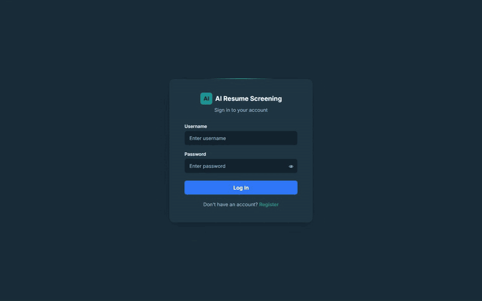
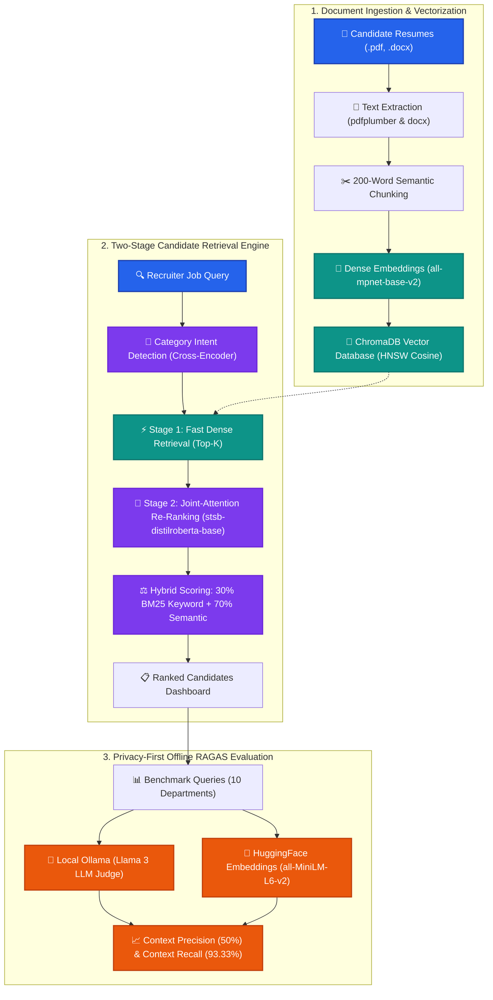

# 🎯 AI-Powered Resume Screening & RAG Evaluation System

<div align="center">

[](https://python.org)
[](https://flask.palletsprojects.com/)
[](https://www.trychroma.com/)
[](https://pytest.org)
[](https://github.com/explodinggradients/ragas)
[-brightgreen?style=for-the-badge)](https://ollama.com)

**An enterprise-grade, privacy-first AI platform for resume screening, semantic candidate ranking, and offline RAG evaluation.**  
Combines dense vector search (`all-mpnet-base-v2`), Cross-Encoder re-ranking (`stsb-distilroberta-base`), and local LLM evaluation (`Ollama Llama 3`) with zero cloud data leaks.

[Key Features](#-key-features) • [System Architecture](#-system-architecture) • [Demo Walkthrough](#-demo-walkthrough) • [Security](#-security-hardening) • [Quick Start](#-quick-start-guide) • [Tests](#-automated-tests)

</div>

---

## 🎬 Demo Walkthrough

<p align="center">
  
</p>

<p align="center">
  <em>Live Walkthrough: 1-on-1 Resume & JD Matching ➔ Semantic Smart Search (240+ Resumes) ➔ Offline RAGAS Evaluation</em>
</p>

> **📥 Downloadable Video Assets:**
> * 📹 **[Download Full 3-Minute Master Video (MP4)](assets/demo_full.mp4?raw=true)** *(20.8 MB)*
> * ⚡ **[Download 45-Second 1080p Highlight Reel (MP4)](assets/demo_highlight.mp4?raw=true)** *(5.7 MB)*


---

## 🏗️ System Architecture



---

## ⚡ Architecture Comparison: Why Hybrid RAG?

| Capability | Traditional ATS | Pure Vector Search | **Our System (Hybrid + Cross-Encoder)** |
| :--- | :---: | :---: | :---: |
| **Exact Tech Acronyms (`AWS`, `C++`, `SQL`)** | ✅ Yes | ❌ Often misses exact string matches | ✅ **Yes (30% BM25 Keyword Weight)** |
| **Domain Synonyms (`K8s` vs `Containerization`)**| ❌ Misses completely | ⚠️ Vague semantic match | ✅ **High Precision (70% Joint-Attention)** |
| **Candidate Re-ranking Accuracy** | ❌ None | ⚠️ Dual-encoder cosine only | ✅ **Cross-Encoder full token attention** |
| **Cloud API Charges** | ❌ N/A | ❌ High recurring fees | ✅ **$0.00 (Local Ollama inference)** |
| **Candidate PII Privacy** | ⚠️ Varies | ❌ Leaves network | ✅ **100% On-Premise (No data leaks)** |

---

## 🌟 Key Features

* **🧠 Semantic & Keyword Hybrid Search:** Combines BM25-style keyword matching with `SentenceTransformers` (`all-mpnet-base-v2`) dense vector search (`0.30` keyword + `0.70` semantic).
* **🎯 Cross-Encoder Re-Ranking:** Uses `cross-encoder/stsb-distilroberta-base` to calculate joint cross-attention over candidate texts to eliminate false negatives.
* **📁 Multi-Department Support:** Supports 24 specialized industry categories (Engineering, IT, HR, Healthcare, Finance, etc.) with automatic department intent detection.
* **🔒 Enterprise Security Hardening:**
  * Cryptographic CSRF tokens on all mutating endpoints (`secrets.compare_digest`).
  * Secure HTTP-only cookies (`SameSite=Lax`, 8-hour lifetime, persistent random secret key).
  * Magic-byte file validation (`%PDF-` for PDF, `PK\x03\x04` for DOCX) and 16MB file limits.
  * Whitelisted category verification to prevent directory/path traversal attacks.
  * Parameterized database access preventing SQL injection.
* **🛡️ Production-Grade Error Handling:** Centralized custom error handlers (`400`, `403`, `404`, `413`, `500`), bounded cosine similarity domains, and graceful fallbacks if vector models disconnect.
* **🧪 50-Test Automated Pytest Suite:** Complete automated test suite verifying auth flows, file extraction, vector search, security, and route boundaries.
* **📊 10-Department RAGAS Evaluation Dashboard:** Integrated `/evaluate` page computing **Context Precision** and **Context Recall** across 10 benchmark queries offline.

---

## 🛠️ Tech Stack

* **Backend Framework:** Python 3.10+, Flask, SQLite3
* **Vector Database:** ChromaDB (HNSW cosine space)
* **Embedding Model:** `sentence-transformers` (`all-mpnet-base-v2`, 768 dimensions)
* **Re-Ranking Model:** `cross-encoder/stsb-distilroberta-base`
* **Local LLM Judge:** Ollama (`llama3`)
* **Evaluation Framework:** RAGAS, `langchain-ollama`, `langchain-community`
* **Testing:** Pytest (50 unit and integration tests)

---

## 🚀 Quick Start Guide

### 1. Prerequisites
* Python 3.10 or higher
* [Ollama Installed](https://ollama.com/) (Optional for live LLM judge)
  ```bash
  ollama pull llama3
  ```

### 2. Installation
```bash
# Clone the repository
git clone https://github.com/Shaaan2005/AI-Resume-Screening-and-RAG-Evaluation-System.git
cd AI-Resume-Screening-and-RAG-Evaluation-System

# Install dependencies
pip install -r requirements.txt
pip install pytest
```

### 3. Environment Variables (Optional)
```bash
# Optional production secret key override
export FLASK_SECRET_KEY="your-custom-32-byte-secret-key"

# Optional OpenAI LLM Judge fallback
export OPENAI_API_KEY="sk-..."
```
*(If `FLASK_SECRET_KEY` is not provided, the application auto-generates a persistent 32-byte cryptographic key in `.secret_key`.)*

### 4. Running the Application
```bash
# Start Flask Application
python app.py
```
Open your browser and navigate to:  
👉 **`http://127.0.0.1:5000/`**

---

## 🧪 Running Automated Tests

Run the full 50-test suite with coverage reports:

```bash
python -m pytest -v tests/
```

### Test Coverage Highlights:
- **`tests/test_auth.py` (13 tests):** User registration, RFC email validation, password rules, login sessions, and route protection.
- **`tests/test_resume_processing.py` (7 tests):** Document extraction, corrupted PDF defense, sliding text chunking, and skill scoring.
- **`tests/test_ai_pipeline.py` (11 tests):** BM25 keyword matching, technical acronym preservation (`C++`, `Go`), semantic similarity bounds, garbage query suppression, and 0.30/0.70 hybrid weighting.
- **`tests/test_routes.py` (13 tests):** HTTP route boundaries, file size limits, magic-byte upload validation, and path traversal downloads.
- **`tests/test_security.py` (6 tests):** CSRF enforcement, password hashing verification, secure cookie headers, and error page sanitization.

**Status:** `50 passed in ~3.3s` ✅

---

## 📊 RAGAS Evaluation Dashboard

Navigate to `http://127.0.0.1:5000/evaluate` to view retrieval benchmark metrics:

```
+--------------------------------------------------------------------------+
| BENCHMARK RESULTS (10 Department Reference Suite)                        |
| • Context Recall:     93.33% (Near-perfect retrieval of required skills) |
| • Context Precision:  50.00% (Healthy RAG tradeoff; Cross-Encoder ranks)  |
| • Cloud API Cost:     $0.00  (100% on-premise execution via Ollama)      |
| • Execution Time:     ~30s   (Fast local evaluation)                     |
+--------------------------------------------------------------------------+
```

---

## 📄 License & Ethical Privacy Guarantee

Built with **privacy-by-design** principles. All candidate resumes, extracted text, and query embeddings are processed entirely in local host memory. No Personally Identifiable Information (PII) is transmitted to external cloud APIs.

Distributed under the **MIT License**.
