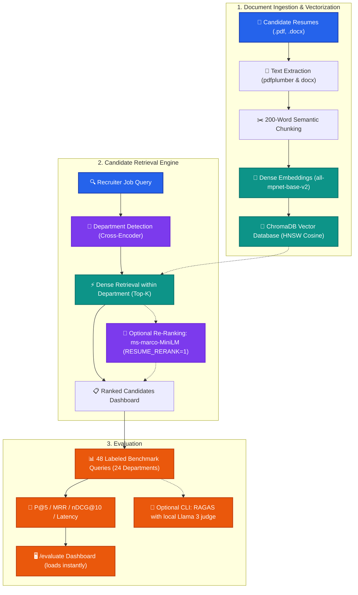

# 🎯 AI-Powered Resume Screening & RAG Evaluation System

<div align="center">

[](https://python.org)
[](https://flask.palletsprojects.com/)
[](https://www.trychroma.com/)
[](https://github.com/Shaaan2005/AI-Resume-Screening-and-RAG-Evaluation-System/actions/workflows/tests.yml)
[](https://github.com/explodinggradients/ragas)
[-brightgreen?style=for-the-badge)](https://ollama.com)

**A privacy-first AI platform for resume screening, semantic candidate ranking, and offline RAG evaluation.**  
Combines dense vector search (`all-mpnet-base-v2`), cross-encoder department detection, a reproducible retrieval benchmark, and optional local LLM evaluation (`Ollama Llama 3`) with zero cloud data leaks.

[Key Features](#-key-features) • [System Architecture](#-system-architecture) • [Benchmark](#-retrieval-benchmark) • [Demo Walkthrough](#-demo-walkthrough) • [Security](#-security-hardening) • [Quick Start](#-quick-start-guide) • [Tests](#-automated-tests)

</div>

---

## 🎬 Demo Walkthrough

<p align="center">
  
</p>

<p align="center">
  <em>Live Walkthrough: Semantic Smart Search (242 Resumes) ➔ 1-on-1 Resume & JD Matching ➔ Retrieval Benchmark</em>
</p>

> **📥 Downloadable Video Assets:**
> * 📹 **[Download Full Walkthrough (MP4, 42 s)](assets/demo_full.mp4?raw=true)** *(3.5 MB)*
> * ⚡ **[Download 1080p Highlight Reel (MP4, 2× speed, 21 s)](assets/demo_highlight.mp4?raw=true)** *(3.7 MB)*


---

## 🏗️ System Architecture



---

## 📏 Retrieval Benchmark

Every ranking choice in this project is measured with a reproducible benchmark ([`benchmark/`](benchmark/)): **48 labeled recruiter queries** (2 per job category) run against the 242 sample resumes. A result counts as relevant when it comes from the query's category.

| Setup | P@5 | MRR | nDCG@10 | Latency |
| :--- | ---: | ---: | ---: | ---: |
| **Dense retrieval only (current default)** | **0.567** | **0.843** | **0.513** | **32 ms** |
| STS cross-encoder + 30% keywords (original design) | 0.413 | 0.627 | 0.400 | 347 ms |
| MS MARCO MiniLM re-ranker | 0.554 | 0.805 | 0.502 | 163 ms |
| BGE reranker base | 0.508 | 0.760 | 0.469 | 663 ms |

**What it showed:** the original re-ranking stage made results *worse* (nDCG@10 0.513 → 0.400) while making search 10–20× slower (timings vary between runs). The STS model it used was trained for sentence similarity, not search relevance. Search-tuned re-rankers (MS MARCO, BGE), BM25 keyword blending, and blending re-ranker and dense scores all came out within noise of plain dense retrieval. So **re-ranking is now off by default** and available as an option (`RESUME_RERANK=1`, MS MARCO MiniLM).

**Limits:** 48 queries is small, and category labels can't measure ranking *within* a department (e.g. Python vs. Java engineers), which is where a re-ranker could still help. Full tables, including the held-out test split and blend weights: [`benchmark/RESULTS.md`](benchmark/RESULTS.md).

```bash
python benchmark/run_benchmark.py            # add --rebuild to rebuild its index
```

---

## 🌟 Key Features

* **🧠 Dense Semantic Search:** `all-mpnet-base-v2` embeddings over 200-word resume chunks in ChromaDB; each resume is ranked by its best-matching chunk.
* **📏 Benchmark-Driven Ranking:** A reproducible 48-query benchmark showed the original cross-encoder re-ranker lowered nDCG@10 from 0.513 to 0.400, so re-ranking is now opt-in (`RESUME_RERANK=1`, `ms-marco-MiniLM-L-6-v2`, optional BM25 keyword blend).
* **📁 Multi-Department Support:** Supports 24 specialized industry categories (Engineering, IT, HR, Healthcare, Finance, etc.) with automatic department intent detection.
* **🔒 Security Hardening:**
  * Cryptographic CSRF tokens on all mutating endpoints (`secrets.compare_digest`).
  * Secure HTTP-only cookies (`SameSite=Lax`, 8-hour lifetime, persistent random secret key).
  * Magic-byte file validation (`%PDF-` for PDF, `PK\x03\x04` for DOCX) and 16MB file limits.
  * Whitelisted category verification to prevent directory/path traversal attacks.
  * Parameterized database access preventing SQL injection.
* **🛡️ Robust Error Handling:** Centralized custom error handlers (`400`, `403`, `404`, `413`, `500`), bounded cosine similarity domains, and graceful fallbacks if vector models disconnect.
* **🧪 102-Test Automated Pytest Suite:** Complete automated test suite verifying auth flows, file extraction, vector search, security, and route boundaries.
* **📊 Benchmark Dashboard:** The `/evaluate` page shows the retrieval benchmark instantly: every setup compared, plus query-by-query results. LLM-judged RAGAS scoring is available from the command line.

---

## 🛠️ Tech Stack

* **Backend Framework:** Python 3.11+, Flask, SQLite3
* **Vector Database:** ChromaDB (HNSW cosine space)
* **Embedding Model:** `sentence-transformers` (`all-mpnet-base-v2`, 768 dimensions)
* **Department Detection:** `cross-encoder/stsb-distilroberta-base`
* **Optional Re-Ranker:** `cross-encoder/ms-marco-MiniLM-L-6-v2` (+ `rank_bm25` keyword blend)
* **Optional LLM Judge (CLI):** Ollama (`llama3`)
* **Evaluation Framework:** RAGAS, `langchain-ollama`, `langchain-community`
* **Testing:** Pytest (102 unit and integration tests)

---

## 📚 Dataset

The sample resumes in `resumes/` are a subset of the **[Resume Dataset](https://www.kaggle.com/datasets/snehaanbhawal/resume-dataset)** by Snehaan Bhawal on Kaggle (released under **CC0: Public Domain**), originally collected from livecareer.com.

- **Used here:** about 10 resumes from each of the dataset's 24 job categories (242 PDFs in total), renamed by category prefix (e.g. `AC1.pdf` for Accountant).
- **Full dataset:** about 2,400 resumes in PDF and CSV form.

---

## 🚀 Quick Start Guide

### 1. Prerequisites
* Python 3.11 or higher (CI runs on 3.14)
* [Ollama Installed](https://ollama.com/) (optional, only for `evaluate_ragas.py --judge ollama`)
  ```bash
  ollama pull llama3
  ```

### 2. Installation
```bash
# Clone the repository
git clone https://github.com/Shaaan2005/AI-Resume-Screening-and-RAG-Evaluation-System.git
cd AI-Resume-Screening-and-RAG-Evaluation-System

# Install dependencies
pip install -r requirements.txt
```

### 3. Environment Variables (Optional)
```bash
# Optional production secret key override
export FLASK_SECRET_KEY="your-custom-32-byte-secret-key"

# Optional OpenAI LLM Judge fallback
export OPENAI_API_KEY="sk-..."
```
*(If `FLASK_SECRET_KEY` is not provided, the application auto-generates a persistent 32-byte cryptographic key in `.secret_key`.)*

### 4. Building the Search Index
The vector index is not committed. Build it once from the sample resumes in `resumes/` (takes a few minutes):
```bash
python vector_store.py
```

### 5. Running the Application

**Windows, one-time setup (optional):** start the server automatically at login and add desktop shortcuts to open or stop it:
```powershell
powershell -ExecutionPolicy Bypass -File scripts\windows\install_shortcuts.ps1    # add -Remove to undo
```

**Share it on a public link (Windows, free, no account):** install Cloudflare's tunnel once with `winget install Cloudflare.cloudflared`, then run `scripts\windows\share_public.ps1` (or the "Share AI Resume Screening" desktop shortcut). It prints a temporary `https://….trycloudflare.com` link that works while your PC is on. While sharing, the app runs in demo mode on a clean index of only the sample resumes, so your own uploads are never visible. Press Ctrl+C to stop.

**Or start it manually:**
```bash
# Start Flask Application
python app.py

# Optional: enable the Flask debugger (local development only, never on a shared network)
# FLASK_DEBUG=1 python app.py
```
Open your browser and navigate to:  
👉 **`http://127.0.0.1:5000/`**

---

## 🌐 Running with Docker / Deploying

The repo ships a `Dockerfile` that runs the app with `gunicorn` on port 7860. Building the image also downloads both models and builds the search index, so the container starts fast. It runs in **demo mode** (`DEMO_MODE=1`): uploaded resumes are scored and then deleted, never added to the shared index.

```bash
# Try the container locally
docker build -t resume-screening .
docker run -p 7860:7860 resume-screening        # -> http://localhost:7860

# Deploy to a Hugging Face Space (Docker Spaces need a Hugging Face PRO subscription)
hf auth login
python deploy/deploy_hf_space.py                 # -> https://huggingface.co/spaces/<you>/ai-resume-screening
```

The image needs about 2 GB of RAM, so it also runs on Google Cloud Run or any Docker host with that much memory (free tiers with 512 MB are too small). The Hugging Face deploy script uploads only git-tracked app files (no local database, uploads or secrets), replaces this README with [`deploy/space_README.md`](deploy/space_README.md), and sets a random `FLASK_SECRET_KEY` secret on the first deploy.

---

## 🗂️ Project Layout

```
app.py              # Entry point: python app.py
webapp/             # Flask app factory + blueprints
  __init__.py       #   create_app(): config, security, blueprint registration
  auth.py           #   /login, /register, /logout
  search.py         #   /, /search, /resume/<category>/<file>
  upload.py         #   /upload (validate, score, index a single resume)
  evaluate.py       #   /evaluate (benchmark dashboard)
  security.py       #   CSRF, login_required, error pages, secret key
  db.py, history.py #   SQLite users, recent-analyses history
query_parsing.py    # Category detection, requested-count parsing, garbage filtering
chroma_search.py    # Dense retrieval over ChromaDB; optional re-ranking + BM25 blend
resume_engine.py    # PDF/DOCX extraction, chunking, role-specific skill scoring
vector_store.py     # Rebuilds the ChromaDB index from resumes/
evaluate_ragas.py   # Optional CLI: heuristic + LLM-judged RAGAS evaluation
benchmark/          # Ranking benchmark: labeled queries, runner, RESULTS.md
tests/              # Pytest suite (run in CI via .github/workflows/tests.yml)
scripts/            # Diagnostic scripts (skill scores, category detection checks)
docs/               # Internship project report and its generator
Dockerfile          # Container for the public demo (gunicorn, port 7860, DEMO_MODE=1)
deploy/             # Hugging Face Space deploy script + Space README
```

---

## 🧪 Running Automated Tests

Run the full 102-test suite:

```bash
python -m pytest -v
```

### Test Coverage Highlights:
- **`tests/test_auth.py` (18 tests):** User registration, email validation, password rules, case-insensitive usernames, login throttling stored in the database (survives restarts, shared by workers), POST-only logout, and route protection.
- **`tests/test_resume_processing.py` (9 tests):** Document extraction, corrupted PDF defense, sliding text chunking, whole-word skill matching, and role-specific skill scoring.
- **`tests/test_ai_pipeline.py` (36 tests):** Keyword-coverage matching, technical acronym preservation (`C++`, `Go`), semantic similarity bounds, garbage query suppression, dense-only default, re-ranked-first ordering, BM25 score normalisation, per-user upload visibility, score-based recommendations, contact masking, query-count parsing, department detection (named departments win over the model's guess), searching the full query sentence instead of stripped keywords, an uploaded copy of a sample resume replacing it in results, no department for queries with no job words, repaired garbled PDF text, keyword scores measured against the job description's skills, and copied uploads keeping the original's department.
- **`tests/test_routes.py` (33 tests):** HTTP route boundaries, file size limits, magic-byte upload validation, path traversal downloads, the benchmark dashboard, demo-mode uploads, private per-user history, duplicate-free re-uploads, owner-only file access, a clear notice when no resume matches well, a clear error for scanned PDFs with no readable text, shareable GET search URLs, multi-department searches, count validation, verdict-free department browsing, security headers, styled error pages, and reopening or deleting saved analyses.
- **`tests/test_security.py` (6 tests):** CSRF enforcement, password hashing verification, secure cookie headers, and error page sanitization.

**Status:** `102 passed` ✅ (also run on every push by GitHub Actions)

---

## 📊 Evaluation

**Dashboard:** open `http://127.0.0.1:5000/evaluate`. It shows the saved [Retrieval Benchmark](#-retrieval-benchmark) results instantly: headline scores for the setup in use, every setup compared, and how each of the 48 queries did. To refresh the numbers, run `python benchmark/run_benchmark.py`.

**Optional LLM-judged RAGAS (command line):** RAGAS asks a language model to grade each retrieved resume, which is slow on local hardware (roughly 10–20 minutes with Llama 3), so it isn't part of the web page.

```bash
python evaluate_ragas.py                  # fast heuristic check only
python evaluate_ragas.py --judge ollama   # + RAGAS with local Llama 3 (free; needs `ollama pull llama3`)
python evaluate_ragas.py --judge openai   # + RAGAS with OpenAI (reads OPENAI_API_KEY)
```

---

## 📄 License & Ethical Privacy Guarantee

Built with **privacy-by-design** principles. All candidate resumes, extracted text, and query embeddings are processed entirely in local host memory. No Personally Identifiable Information (PII) is transmitted to external cloud APIs.

Distributed under the **MIT License**.
